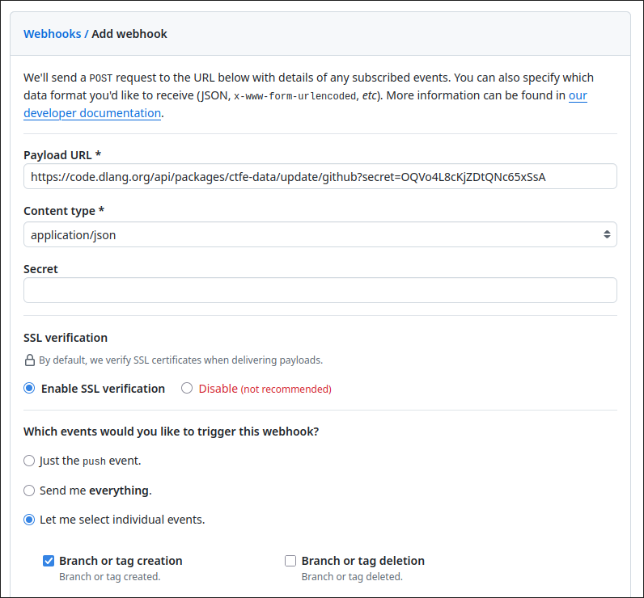

# Triggering version updates over HTTP

To queue an update of your package you can use the `POST /api/packages/:packageName/update` endpoint.

## `GET /my_packages/:packageName/webhook` (authenticated)

Returns whether a webhook secret is configured for the package **without regenerating it**.

Requires a logged-in package admin session (same auth as the My packages UI / `regen_secret`).

Response JSON:

```json
{"package":"mypkg","configured":true}
```

The plaintext secret is intentionally never returned here — it is only shown once after `POST .../regen_secret`.

## `POST /api/packages/:packageName/update`

Queues an update for the specified package.

Query params:
`secret`: string (optional) provide the secret as query
`header`: string (optional) provide which header is used to check the secret (must start with X-)

Body params: (application/x-www-form-urlencoded, multipart/form-data or application/json)
`secret`: string (optional) provide the secret as body param

## `POST /api/packages/:packageName/update/github`

Queues an update for the specified package. Compatible with GitHub webhooks. Must pass the package secret as a query param on the payload URL (not in GitHub’s webhook “Secret” field).

Triggers on these `X-GitHub-Event` values:

| Event | When it helps |
| --- | --- |
| `release` | Preferred for release-driven packages. Fires for release created, edited, published, unpublished, or deleted. |
| `create` | Tag or branch creation (legacy / tag-only workflows). Branch creates are noisy if you use feature branches. |
| `delete` | Tag or branch deletion. A package update removes registry versions whose refs no longer exist. |

Webhook `ping` validation succeeds if the hook listens for **any** of those events.

This can be configured in GitHub like this (enable **Releases**, and optionally **Branch or tag deletion**; **Branch or tag creation** remains supported):



## `POST /api/packages/:packageName/update/gitlab`

Queues an update for the specified package. Compatible with GitLab webhooks and only triggers on `tag_push` events. The secret is specified in the GitLab control panel.

Calls `POST /api/packages/:packageName/update` with `header=X-Gitlab-Token` query param after hook parsing.
